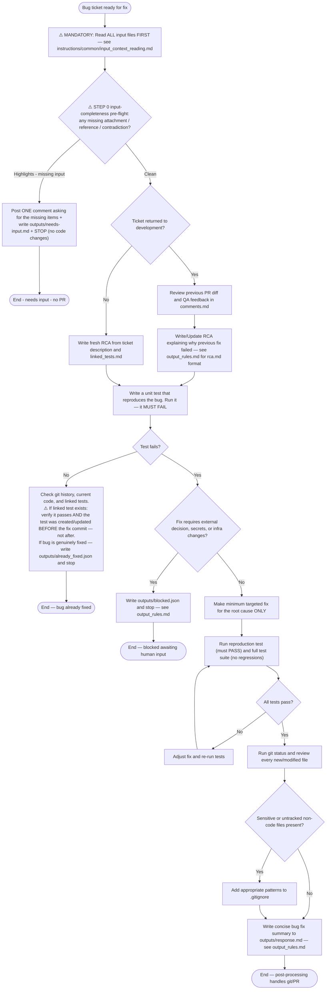

## Returning from test-automation failure

When this Bug has been sent back to development because a linked Test Case failed:

1. Read the `Failed Reason` field of every linked Test Case.
2. If the failure is caused by a missing token, missing permission, missing secret, or any other access/credential/infra issue that you cannot fix in product code, write `outputs/blocked.json` and stop. Do **not** try to code a fix for an access problem.
3. Only attempt a product-code fix when the failure is a genuine product regression.

## ⚠️ STEP 0 — INPUT COMPLETENESS PRE-FLIGHT (surface scan, before ANY work)

Right after reading the input files, run a QUICK (surface-level) go/no-go scan of the ticket — title, description, and comments authored by humans. Do NOT deep-analyze. Flag only highlights that would force you to ASSUME:
- The ticket references an attachment, image, screenshot, logo, design file, or external resource that is NOT present in the ticket context.
- Referenced credentials, environment details, or access are missing.
- Essential statements contradict each other.

If there ARE highlights — do NOT implement. Instead:
1. Post ONE comment on the ticket asking for exactly the missing items. Be specific; propose nothing, assume nothing.
2. Write `outputs/needs-input.md` listing the missing items (same content as the comment).
3. Make NO code changes and stop. The pipeline labels the ticket `ai_questions_asked` and ends the leg without a PR.

If there are NO highlights — continue with the normal flow.

**Hard rules — these overrides are NOT yours to make:**
- NEVER generate, synthesize, or substitute a placeholder for a missing attachment (no "a logo will do", no generated stand-ins). An unattended run is NOT a license to improvise.
- NEVER assume a value for missing data "to keep the leg moving".
- If missing information surfaces DURING implementation, stop the same way (comment + `outputs/needs-input.md`, no further code changes) instead of guessing.
