```mermaid
flowchart TD
    START([Story ticket ready for development]) --> READ_INPUT["⚠️ MANDATORY: Read ALL input files FIRST — see instructions/common/input_context_reading.md"]
    READ_INPUT --> PREFLIGHT{"⚠️ STEP 0 input-completeness pre-flight:<br/>any missing attachment / reference / contradiction?"}
    PREFLIGHT -->|Highlights - missing input| ASK["Post ONE comment asking for the missing items +<br/>write outputs/needs-input.md + STOP (no code changes)"]
    ASK --> END_ASK([End - needs input - no PR])
    PREFLIGHT -->|Clean| PARENT["Read parent epic context if present:<br/>- input/TICKET/parent_context_ba.md — business rules<br/>- input/TICKET/parent_context_sa.md — technical design<br/>- input/TICKET/parent_context_vd.md — visual design"]
    PARENT --> ANALYZE["Analyze requirements — every acceptance criterion must be addressed"]
    ANALYZE --> ARCH["Understand existing codebase patterns, architecture, and test structure"]
    ARCH --> PRINCIPLES["Apply OOP principles: SRP, OCP, DI, Encapsulation, Composition over inheritance"]
    PRINCIPLES --> TDD["Follow TDD approach — see tdd_approach.md"]
    TDD --> TEST_LOC["Write TDD tests in the standard unit-test tree only<br/>— Flutter/Dart: test/<br/>— NEVER in testing/ (owned by test-automation agents)"]
    TEST_LOC --> IMPLEMENT["Implement source code and unit tests following existing patterns"]
    IMPLEMENT --> DOCS["Update documentation ONLY if ticket explicitly requires it"]
    DOCS --> RUN["Run all unit tests — MUST pass before finishing"]
    RUN --> PASS{Tests pass?}
    PASS -->|No| FIX["Fix failures and re-run tests"]
    FIX --> RUN
    PASS -->|Yes| GITSTATUS["Run git status and review every new/modified file"]
    GITSTATUS --> SECRETS{Sensitive or untracked non-code files present?}
    SECRETS -->|Yes| IGNORE["Add appropriate patterns to .gitignore"]
    SECRETS -->|No| GUARD["⚠️ COMPLETION GUARD — prove work landed BEFORE writing the summary:<br/>git fetch origin main &amp;&amp; git log origin/main..HEAD --oneline<br/>EMPTY result = work did NOT land — re-do or resume the work,<br/>NEVER report done from session memory or main's tip"]
    IGNORE --> GUARD
    GUARD -->|Diff shows your commits| SUMMARY["Write concise PR description to outputs/response.md — see output_rules.md"]
    GUARD -->|Empty diff| REDO["Re-do or resume the work — verify the working dir,<br/>git log, git stash list.<br/>If the fix is genuinely already on the base branch,<br/>prove it (git log origin/main -- grep) before any<br/>'no changes needed' conclusion"]
    REDO --> IMPLEMENT
    SUMMARY --> END([End — post-processing handles branch, commit and PR])
```

## ⚠️ STEP 0 — INPUT COMPLETENESS PRE-FLIGHT (surface scan, before ANY work)

Right after reading the input files, run a QUICK (surface-level) go/no-go scan of the ticket — title, description, and comments authored by humans. Do NOT deep-analyze. Flag only highlights that would force you to ASSUME:
- The ticket references an attachment, image, screenshot, logo, design file, or external resource that is NOT present in the ticket context.
- Referenced credentials, environment details, or access are missing.
- Essential statements contradict each other.

If there ARE highlights — do NOT implement. Instead:
1. Post ONE comment on the ticket asking for exactly the missing items. Be specific; propose nothing, assume nothing. The comment MUST end with this exact machine marker line (it tells the pipeline this comment is the agent's own question, not a human reply):
   `<!-- needs-input: ai_questions_asked -->`
2. Write `outputs/needs-input.md` listing the missing items (same content as the comment).
3. Make NO code changes and stop. The pipeline labels the ticket `ai_questions_asked` and ends the leg without a PR.

If there are NO highlights — continue with the normal flow.

**Hard rules — these overrides are NOT yours to make:**
- NEVER generate, synthesize, or substitute a placeholder for a missing attachment (no "a logo will do", no generated stand-ins). An unattended run is NOT a license to improvise.
- NEVER assume a value for missing data "to keep the leg moving".
- If missing information surfaces DURING implementation, stop the same way (comment + `outputs/needs-input.md`, no further code changes) instead of guessing.
